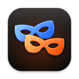

# Gaurav Bhandari

Software engineer at PagarBook. After hours I write small, fast native apps for my Mac and raise a language model from scratch.

## Stuff I'm currently building

<table>
<tr>
<td width="110" align="center"></td>
<td>
<b><a href="https://github.com/kratos-respawned/hop">Hop</a></b>, a macOS launcher 
App search, clipboard history, a calculator, a video downloader, an AirDrop shelf at the notch, and dev tools for ports, worktrees and whatever is heating the Mac. Each keystroke answers in under 0.3 ms. The whole app is 0.9 MB of Swift and AppKit with no dependencies.
</td>
</tr>
<tr>
<td width="110" align="center"></td>
<td>
<b>Masks</b>, a browser where every tab wears a mask 
Each tab has its own login identity, so two accounts on the same site sit side by side in one window. AI agents drive it through a CLI and an MCP server, and they see only the tabs they opened or the ones I share with them. It is Swift, AppKit and WebKit, runs in the App Sandbox, keeps passwords behind the Secure Enclave and sends no telemetry. Private repo.
</td>
</tr>
<tr>
<td width="110" align="center"></td>
<td>
<b>Burrow</b>, a Finder replacement for developers 
Folders list through native kernel calls, search runs on its own index that skips <code>node_modules</code> and build folders, and the status bar shows the git branch and its sibling worktrees. It is also 0.9 MB with no dependencies. Private repo.
</td>
</tr>
</table>

### A private line between the apps

Masks can hand a download to Hop along with the site login it needs. That request travels over a private protocol written for these apps. Each app verifies the other's code signature before any request moves, so no other process can pose as either app.

## Vani

A language model I am raising from scratch on my laptop, in one 870-line PyTorch file.

- She was born as 2 layers of random weights and grew to 8 layers and 7.5 million parameters as she read more.
- Every day ends in sleep, when she replays her memories in dreams and learns from them.
- Seven hormone-like scores, dopamine, cortisol and curiosity among them, decide when she is tired, scared, or curious enough to pick her own book.
- An exam of 226 questions she was never taught measures every change. She got 4 right on day 112 and gets about 182 now.

## At PagarBook

I work across the backend, the web app and the mobile apps. Recently I built the Form 16 signer, a Tauri desktop app that signs Form 16 PDFs in bulk with a Class 3 DSC USB token.

Everything below the UI is low-level Rust that talks to the USB token, builds the digital signature and writes it into the PDF with a hand-written PDF writer. A few wrong PINs lock a token for good, so every check that needs no PIN runs first, and one PIN entry signs the whole batch.

## Tools

